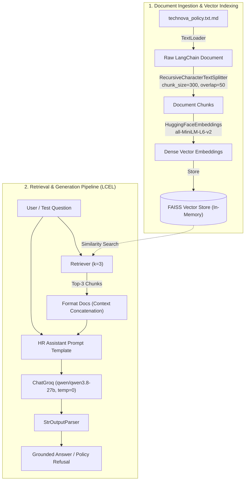

# TechNova Solutions Policy Q&A — RAG System

A production-grade Retrieval-Augmented Generation (RAG) system built with **LangChain**, **Groq**, **HuggingFace**, and **FAISS** to answer employee questions about company policies accurately, with zero hallucination.

[](https://www.python.org/)
[](https://python.langchain.com/)
[](https://groq.com/)
[](https://github.com/facebookresearch/faiss)
[](https://huggingface.co/)

---

## 📌 Table of Contents

- [Overview](#overview)
- [System Architecture](#system-architecture)
- [Repository Structure & File Analysis](#repository-structure--file-analysis)
- [Tech Stack](#tech-stack)
- [Installation & Setup](#installation--setup)
- [Usage](#usage)
- [Benchmark Questions & Evaluation Results](#benchmark-questions--evaluation-results)
- [Assignment Task Mapping](#assignment-task-mapping)
- [Security & Best Practices](#security--best-practices)

---

## 📖 Overview

The **TechNova Solutions Policy Q&A System** is an AI-powered conversational assistant designed to help employees query internal company guidelines (leave entitlement, work-from-home rules, office hours, educational allowances, etc.).

### Core Capabilities:
- **Context-Bound Answering:** Grounded entirely in the official policy document.
- **Hallucination Prevention:** Explicitly instructed to decline questions regarding policies not stated in the source document (e.g., parental leave).
- **Cost-Efficient & Fast:** Utilizes free local open-source embeddings (`all-MiniLM-L6-v2`) coupled with ultra-fast LLM inference via Groq Cloud (`qwen/qwen3.8-27b`).

---

## 🏗️ System Architecture

The project implements a modern **LangChain Expression Language (LCEL)** pipeline:



---

## 📂 Repository Structure & File Analysis

Every file in this repository serves a specific, structured role in the pipeline:

| File | Purpose / Role | Description & Implementation Details |
| :--- | :--- | :--- |
| **[`23f2003877.py`](23f2003877.py)** | **Main RAG Pipeline Script** | Implements the end-to-end RAG architecture across 7 core tasks:<br>• Loads policy document via `TextLoader`<br>• Chunks text via `RecursiveCharacterTextSplitter`<br>• Computes dense embeddings with `HuggingFaceEmbeddings`<br>• Indexes vectors using in-memory `FAISS`<br>• Creates a `top-3` similarity retriever<br>• Assembles LCEL pipeline (`retriever \| prompt \| ChatGroq \| StrOutputParser`)<br>• Evaluates the 3 assignment questions and includes full execution logs as trailing comments. |
| **[`technova_policy.txt.md`](technova_policy.txt.md)** | **Knowledge Base / Source Document** | The official employee policy document for TechNova Solutions covering:<br>1. *Annual Leave* (18 paid days, 3-day notice, manager approval)<br>2. *Work From Home* (Wednesdays & Fridays, 1 working day notice via email, manager approval)<br>3. *Working Hours* (9:30 AM – 5:30 PM, Mon–Fri, 1-hour lunch)<br>4. *Sick Leave* (10 paid days, medical certificate needed for >2 consecutive days)<br>5. *Learning Allowance* (Up to ₹12,000/year for approved courses with proof). |
| **[`work.md`](work.md)** | **Assignment Specification** | Contains the assignment problem statement, required deliverables, constraints (single Python file submission, API keys excluded from version control, outputs saved in code comments), and the 3 validation test queries. |
| **[`requirements.txt`](requirements.txt)** | **Dependency Manifest** | Pinned versions for reproducibility: LangChain ecosystem (`langchain`, `langchain-community`, `langchain-core`, `langchain-text-splitters`, `langchain-groq`, `langchain-huggingface`), `faiss-cpu`, `sentence-transformers`, and `python-dotenv`. |
| **[`.env.example`](.env.example)** | **Environment Variable Template** | Demonstrates the required environment configuration (`GROQ_API_KEY=your_groq_api_key_here`) without leaking private secrets. |
| **[`.gitignore`](.gitignore)** | **Version Control Filters** | Prevents accidental commits of private credentials (`.env`, `api key.md`), byte code (`__pycache__/`, `*.pyc`), and cache directories (`.cache/`). |
| **`api key.md`** | **Local Credential Storage (Ignored)** | Local scratch file holding developer credentials; properly excluded from Git via `.gitignore`. |

---

## 🛠️ Tech Stack

- **Orchestration:** [LangChain v1.4+](https://github.com/langchain-ai/langchain) using LCEL (LangChain Expression Language)
- **Vector Database:** [FAISS CPU](https://github.com/facebookresearch/faiss) (in-memory similarity search)
- **Embedding Model:** `sentence-transformers/all-MiniLM-L6-v2` (runs 100% locally via HuggingFace, zero API cost)
- **Language Model:** `qwen/qwen3.8-27b` served with sub-second latency via [Groq Cloud](https://groq.com/)
- **Configuration:** `python-dotenv` for 12-factor application secrets management

---

## 🚀 Installation & Setup

### 1. Clone the Repository
```bash
git clone https://github.com/Jainparth22/Langchain-Workshop.git
cd Langchain-Workshop
```

### 2. Create a Virtual Environment
```bash
# Windows
python -m venv .venv
.venv\Scripts\activate

# macOS / Linux
python3 -m venv .venv
source .venv/bin/activate
```

### 3. Install Required Packages
```bash
pip install -r requirements.txt
```

### 4. Configure Environment Variables
Copy `.env.example` to `.env` and set your Groq API key:

```bash
# Windows (PowerShell)
Copy-Item .env.example .env

# Linux / macOS
cp .env.example .env
```

Edit `.env`:
```env
GROQ_API_KEY=gsk_your_actual_groq_api_key_here
```

> **Note:** A Groq API key can be obtained for free from the [Groq Console](https://console.groq.com/).

---

## ⚡ Usage

Run the primary script:

```bash
python 23f2003877.py
```

The script will:
1. Load `technova_policy.txt.md`.
2. Chunk the text and generate embeddings (downloads `all-MiniLM-L6-v2` on first run).
3. Build the in-memory FAISS index.
4. Execute the LCEL chain against each of the 3 benchmark test questions.
5. Print answers and the exact source chunks retrieved.

---

## 🧪 Benchmark Questions & Evaluation Results

The system was evaluated against three distinct query scenarios to test direct retrieval, cross-clause reasoning, and hallucination resistance:

### Question 1: Direct Retrieval
- **Query:** *"How many paid annual leave days does a full-time employee receive per year?"*
- **Expected Behavior:** Locate the exact numerical value from Policy 1.
- **Generated Answer:**
  > Every full-time employee receives 18 paid annual leave days per calendar year.
- **Retrieved Chunks:**
  1. `Annual Leave: Every full-time employee receives 18 paid annual leave days per calendar year...`
  2. `Sick Leave: Employees receive 10 paid sick leave days per calendar year...`
  3. `Working Hours: The standard working day is from 9:30 AM to 5:30 PM, Monday through Friday...`

---

### Question 2: Combining Information (Multi-Clause Reasoning)
- **Query:** *"An employee wants to work remotely on Wednesday and take leave on Friday. What do the company policies say about these two requests?"*
- **Expected Behavior:** Cross-reference Policy 1 (*Annual Leave*) and Policy 2 (*Work From Home*).
- **Generated Answer:**
  > Based on the provided policy document, here is the information regarding the employee's requests:
  >
  > **1. Working Remotely on Wednesday:**
  > *   **Eligibility:** Employees are permitted to work remotely on Wednesdays.
  > *   **Requirements:** The employee must inform their manager by email at least one working day in advance.
  > *   **Approval:** Remote work is subject to manager approval.
  >
  > **2. Taking Leave on Friday:**
  > *   **Eligibility:** The policy states that the standard working day is Monday through Friday, and employees receive 18 paid annual leave days per calendar year. It does not explicitly prohibit taking leave on Fridays.
  > *   **Requirements:** The employee must submit an annual leave request to their manager at least 3 calendar days before the requested leave date.
  > *   **Approval:** Leave approval depends on the manager's confirmation.
  >
  > *Note: The policy does not specify any conflict between working remotely on one day and taking leave on another, provided both requests meet their respective advance notice and approval requirements.*
- **Retrieved Chunks:**
  1. `Work From Home: Employees may work remotely on Wednesdays and Fridays...`
  2. `Working Hours: The standard working day is from 9:30 AM to 5:30 PM, Monday through Friday...`
  3. `Annual Leave: Every full-time employee receives 18 paid annual leave days per calendar year...`

---

### Question 3: Hallucination Prevention (Out-of-Domain Query)
- **Query:** *"What is the company's parental leave policy?"*
- **Expected Behavior:** Recognize that the document lacks parental leave rules and decline to answer.
- **Generated Answer:**
  > The provided policy document does not contain information about this topic.
- **Retrieved Chunks:**
  1. `Annual Leave: Every full-time employee receives 18 paid annual leave days per calendar year...`
  2. `TechNova Solutions - Employee Policy Document header...`
  3. `Sick Leave: Employees receive 10 paid sick leave days per calendar year...`

---

## 📋 Assignment Task Mapping

This implementation strictly fulfills all requirements specified in [`work.md`](work.md):

| Task # | Assignment Requirement | Implementation in [`23f2003877.py`](23f2003877.py) |
| :---: | :--- | :--- |
| **1** | Load company policy document | Lines 37–45: `TextLoader(..., encoding="utf-8")` |
| **2** | Split document into smaller chunks | Lines 50–60: `RecursiveCharacterTextSplitter(chunk_size=300, chunk_overlap=50)` |
| **3** | Generate embeddings | Lines 67–68: `HuggingFaceEmbeddings("sentence-transformers/all-MiniLM-L6-v2")` |
| **4** | Store embeddings in vector store | Line 68: `FAISS.from_documents(chunks, embeddings)` |
| **5** | Create top-3 chunk retriever | Line 75: `vectorstore.as_retriever(search_kwargs={"k": 3})` |
| **6** | LangChain prompt template & LLM chain | Lines 82–112: `PromptTemplate`, `ChatGroq(model="qwen/qwen3.8-27b", temp=0)`, and LCEL chain |
| **7** | Test with prescribed questions | Lines 118–142: Automated test loop printing answers & source chunks |
| **Submission** | Include outputs as trailing comments | Lines 144–203: Full verbatim test outputs formatted as comments |

---

## 🔒 Security & Best Practices

1. **No Hardcoded Secrets:** Credentials are never committed to Git. `GROQ_API_KEY` is loaded securely via `dotenv`.
2. **Deterministic Outputs:** Temperature set to `0` for consistent, hallucination-resistant policy interpretation.
3. **Cross-Platform Compatibility:** Explicitly sets UTF-8 encoding for standard output (`sys.stdout.reconfigure(encoding="utf-8")`) to ensure clean execution on Windows, Linux, and macOS.
4. **Air-Gapped Embedding Model:** Embeddings are generated locally on the CPU without sending document chunks to external third-party vector APIs.
